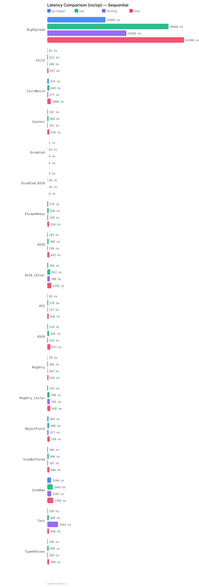
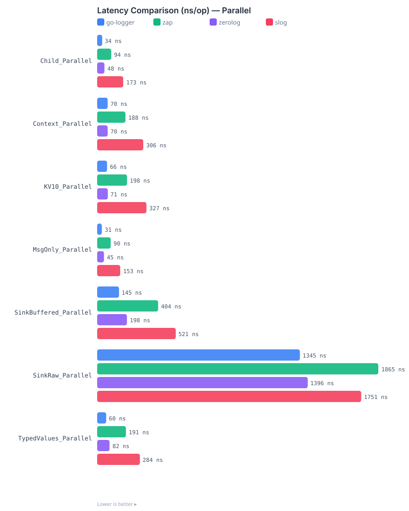
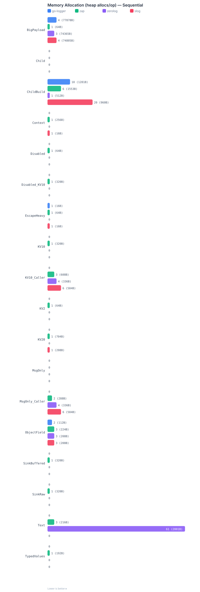
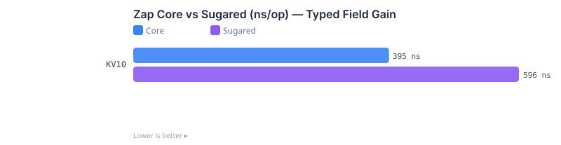

<div align="center">

# go-logger-benchmark

**Performance comparison between [go-logger], [zap], [zerolog] and [slog]**

[go-logger]: https://github.com/kamalyes/go-logger
[zap]: https://github.com/uber-go/zap
[zerolog]: https://github.com/rs/zerolog
[slog]: https://pkg.go.dev/log/slog

[](https://github.com/kamalyes/go-logger-benchmark/actions/workflows/benchmark.yml)

[中文文档](./README_zh.md)

</div>

---

## 📊 Benchmark Charts

### Latency — Sequential



### Latency — Parallel



### Memory Allocation — Sequential



### Zap Core vs Sugared — Typed Field Gain



> Charts are auto-generated on every push via GitHub Actions.

---

## 🧪 Scenarios

Formatting scenarios share the same baseline: JSON format + Info level + `io.Discard` output, each library using its idiomatic API. The `Sink*` scenarios are the exception — they only mean anything against a real file (see below).

| Scenario | Description |
|----------|-------------|
| KV10 | 5 pairs (10 values) of mixed-type fields: 3 string + 2 int |
| **KV2** / **KV20** | 1 pair / 10 pairs. With KV10 that is three points, enough to read off the marginal cost per field |
| KV10_Caller | KV10 with caller (source location) enabled |
| MsgOnly | Plain message without fields |
| **MsgOnly_Caller** | Plain message with caller. Subtract MsgOnly to get caller's net fixed cost |
| Disabled | Level short-circuit: Debug below a WARN threshold |
| **Disabled_KV10** | Level short-circuit carrying 5 field pairs — tests the "raise the level and it is free" assumption |
| **Context** | trace_id propagation. go-logger extracts it itself; the other three need a caller-supplied helper |
| **EscapeHeavy** | A field value that needs escaping (nested JSON + newlines + CJK), unlike the clean ASCII everywhere else |
| **ObjectField** | A struct field. No library has a dedicated branch, so all fall back to reflect / encoding/json |
| **Child** | Child-logger steady state: 4 bound fields, built once and logged many times |
| **ChildBuild** | Rebuild the child logger on every entry (one child per request) |
| **TypedValues** | error + `time.Duration` + int — the types real code logs most, and the ones most likely to fall into a `fmt` fallback |
| **Text** | Text / console format (each library's text path is wholly separate from its JSON path) |
| **BigPayload** | A single 64KB field: behaviour when one entry blows up |
| **SinkRaw** | All four write straight to an `*os.File` — unbuffered, one write syscall per entry |
| **SinkBuffered** | All four buffer output the way each library recommends |

### Why field count needs three points

One data point cannot be extrapolated. Separating "fixed cost" from "cost per field" takes at
least two, and with only KV10 (5 pairs) published, scaling to your own field count is guesswork.
KV2 / KV10 / KV20 give the slope — and show which libraries are visibly non-linear per field.

Spread over three points, a conclusion that KV10 alone hides shows up: go-logger's advantage is
mostly in **fixed cost**, while its marginal cost per field is close to zerolog's — the more
fields, the closer the two get. Reading only the 5-pair row turns that difference in slope into
an apparently constant ratio.

### The `Context` group is not an even comparison, deliberately

go-logger's `*Context` methods extract trace_id themselves. zap / zerolog / slog have no such
layer, so the caller has to write a helper and attach the field explicitly — `traceIDFromCtx` in
the fixtures is that helper. The scenario measures the total cost of *getting trace_id into the
line*, not the cost of one API call.

The asymmetry is stated rather than hidden: the helper does a single `ctx.Value` lookup, while
go-logger's built-in extraction probes an OTel span first and only then falls back to
`ctx.Value`. **go-logger is doing strictly more work here and the numbers count against it.**
Levelling that would misrepresent what each library does by default.

### What `EscapeHeavy` covers

Every other scenario logs clean ASCII, which can be copied in one `memmove`. Real fields embed
JSON, carry newlines and contain CJK, all of which must be rewritten byte by byte. The two paths
do not predict each other — measuring only the first measures only the cheapest case.

This group is also the one scenario added here where **go-logger clearly loses**: with dense
escaping zerolog is faster, and go-logger still takes one heap allocation on that path where
zerolog takes none. Publishing only the flattering scenarios would be pointless — and a loss is
exactly where the next optimization belongs.

### The assumption `Disabled_KV10` corrects

With a single field pair all four look essentially free, which invites the conclusion that
raising the level makes logging cost nothing. At five pairs that needs correcting: arguments are
built **at the call site**, so no amount of early level checking avoids them, and the
short-circuit path gets slower as fields are added.

Allocations are the more interesting part. On a path that is supposed to do nothing at all,
go-logger / zerolog / slog all report 0 allocs/op, while zap's typed `Field`s are constructed and
heap-allocated even when the level rejects the entry — **of the four, only zap keeps producing
garbage from disabled Debug logging**, which turns into real GC pressure on a hot Debug path.

> This section originally claimed that variadic boxing makes those heap allocations unavoidable.
> Measurement disproved it: the boxing does happen, but constants and small integers do not reach
> the heap and the `[]any` does not escape, so the count is zero. Cost claims have to be measured,
> not reasoned about.

### Why `Sink*` has to be here

Every other scenario writes to `io.Discard`, which measures formatting alone. In production the log has to actually land: a bare `*os.File` costs one syscall plus one mutex per entry, and that accounts for 85–97% of the real per-entry cost. Measured against a real file, the spread between the four libraries collapses from 3–5x (under `io.Discard`) to within 1.4x — **tuning or picking a library off the `io.Discard` numbers alone spends all your effort on under 15% of the cost**.

How each library buffers is itself part of the comparison: zap ships `BufferedWriteSyncer` and go-logger ships an async batching pipeline, while zerolog and slog expect the caller to supply `bufio` plus concurrency protection.

> `Sink*` results depend on the filesystem. They are not comparable across machines — only the relative ordering within one machine is meaningful.

### About go-logger's exclusive features

Sanitization, line-size caps and service identity fields have no counterpart in zap / zerolog / slog. Counting them in the four-library tables would charge go-logger for work the others never do, so **those features are switched off in every four-library scenario**. Their real cost is measured separately in `bench_feature_test.go` and reported in its own table.

Each scenario runs sequentially and in parallel (`-Parallel` suffix), plus a Zap Sugared variant to measure the typed-Field gain.

---

## 🚀 Quick Start

```bash
# Run all benchmarks
go test -run='^$' -bench=. -benchmem -count=3 -timeout=30m ./... | tee benchmark_output.txt

# Generate charts + BENCHMARKS.md
go run ./bootstrap/report

# Parse real benchmark output
go test -run='^$' -bench=. -benchmem -count=1 -timeout=10m ./... > benchmark_output.txt
go run ./bootstrap/report -parse benchmark_output.txt
```

---

## 📁 Project Structure

```bash
go-logger-benchmark/
├── bench_kv_test.go               # KV field benchmarks
├── bench_msg_test.go              # Plain message benchmarks
├── bench_disabled_test.go         # Level short-circuit benchmarks
├── bench_child_test.go            # Child-logger (With) benchmarks
├── bench_value_test.go            # Typed-value / text / big-field benchmarks
├── bench_shape_test.go            # Call-shape benchmarks (field count / ctx / escaping / objects)
├── bench_sink_test.go             # Output sink (raw / buffered) benchmarks
├── bench_feature_test.go          # Enablement cost of go-logger-only features
├── loggers.go                     # Four-library aligned fixtures
├── fixtures.go                    # Extended-scenario fixtures (sinks / child loggers / typed values)
├── fixtures_shape.go              # Call-shape fixtures (field count / ctx / escaping / objects)
├── bootstrap/
│   └── report/
│       ├── main.go                # Report + SVG chart generator
│       └── main_test.go           # Report parser unit tests
├── benchmarks/
│   ├── latency.svg                # Sequential latency chart
│   ├── latency_parallel.svg       # Parallel latency chart
│   ├── allocs.svg                 # Memory allocation chart
│   ├── zap_core_vs_sugared.svg    # Zap Core vs Sugared chart
│   └── *.json                     # Raw benchmark data
├── .github/workflows/
│   └── benchmark.yml              # CI auto-benchmark workflow
├── BENCHMARKS.md                  # Detailed data tables
└── go.mod
```

---

## ⚙️ CI Automation

The [benchmark workflow](./.github/workflows/benchmark.yml) runs automatically:

1. On every push to `master` (code changes only)
2. On `upstream-updated` dispatch when [go-logger] publishes a new tag

Each run executes `go test -bench` with 3 iterations against the pinned go-logger ref, generates SVG charts and commits them back to the repo as a single amended benchmark commit.

---

## 📋 Full Data

See [BENCHMARKS.md](./BENCHMARKS.md) for detailed comparison tables with all scenarios.

---

## 📝 License

This project is licensed under the MIT License.
